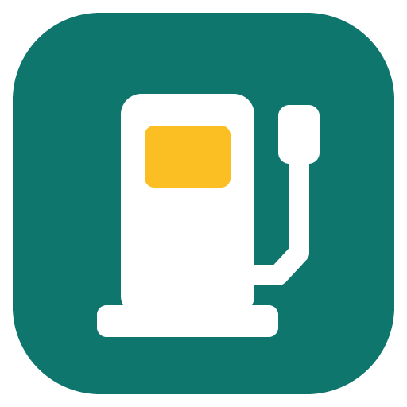
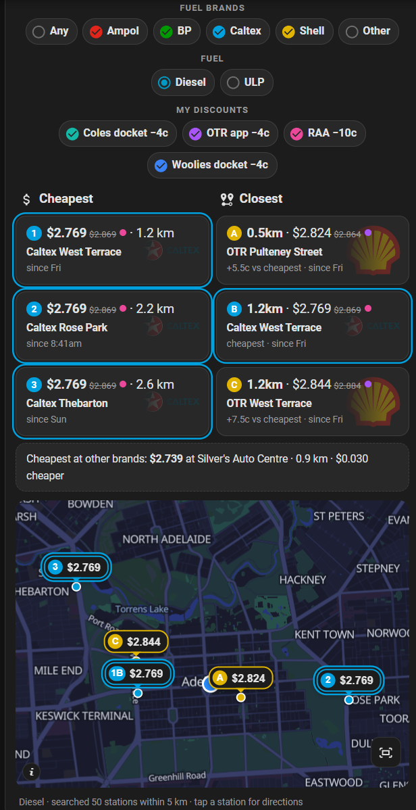
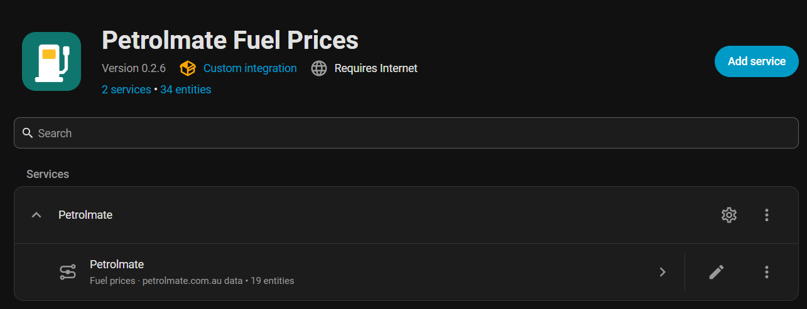
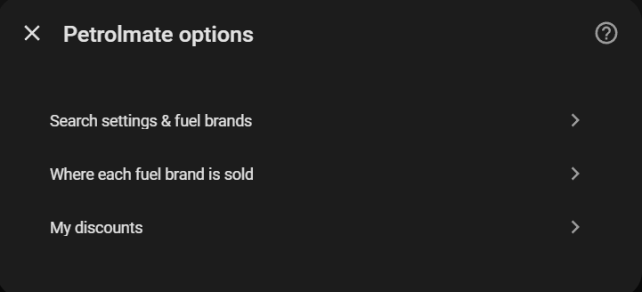
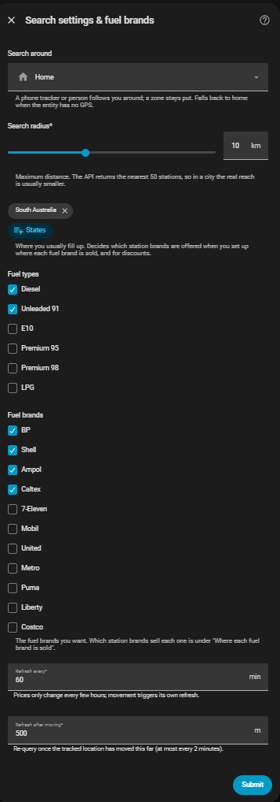
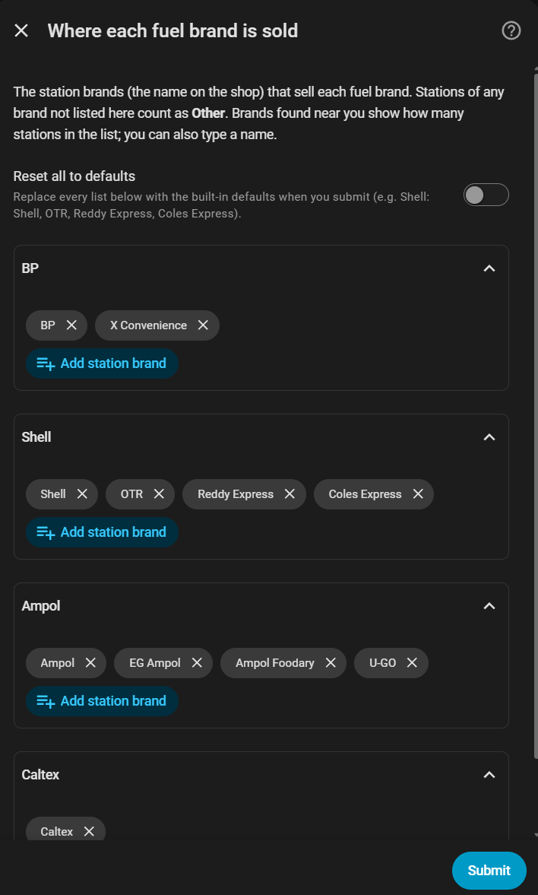
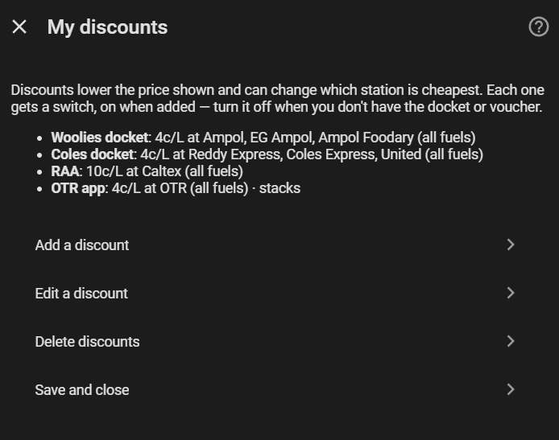
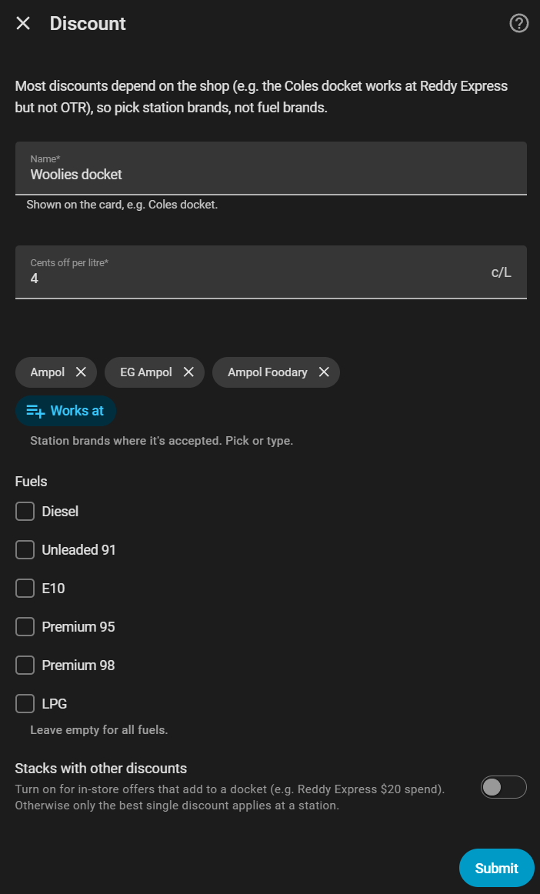

<p align="center"></p>

# Petrolmate Fuel Prices for Home Assistant

[](https://hacs.xyz/docs/faq/custom_repositories)
[](https://github.com/AJErazzor/ha-petrolmate/actions/workflows/validate.yml)

Find the **cheapest** and the **closest** fuel near you, at the fuel brands you use (BP, Shell, Ampol, Caltex, …) and after your own discounts (supermarket dockets, motoring club, app offers). The search follows your phone around, and a bundled dashboard card shows everything at a glance, with a map and one-tap directions.

Prices come from the free [Petrolmate API](https://petrolmate.com.au/home-assistant), which aggregates the Australian state government fuel price schemes. No API key needed.

<p align="center"></p>

## Features

- **Follows you:** search around a phone tracker, a person or a zone. It re-checks after you've moved (500 m by default), not on every GPS ping.
- **Your fuel brands:** pick the fuel brands you want and which station brands sell each one (for example OTR and Reddy Express for Shell, X Convenience for BP). Brands are offered from a list for your state(s) plus whatever was found near you, so there's nothing to misspell.
- **My discounts:** add the discounts you have (cents per litre, which station brands accept it, which fuels, whether it stacks). Prices and rankings use the discounted price, and each discount has a switch for when you're not holding the docket.
- **Any and Other:** *Other* adds stations whose brand isn't assigned to a fuel brand; *Any* ignores your brand ticks for road trips, then puts them back.
- **Every fuel:** Diesel, Unleaded 91, E10, Premium 95, Premium 98 and LPG, with one sensor each.
- **Cheapest and closest:** up to 10 by price and 10 by distance, plus the cheapest station at other brands, so you can see what sticking to your brands costs.
- **Filters as entities:** a fuel-type select and switches for brands, Any, Other and each discount, usable from automations too. Changing them recalculates instantly with no new API call.
- **Dashboard card included:** filter pills, numbered tiles with brand logos, and a map with callouts using Home Assistant's own map tiles. Tap any station for directions: Apple Maps on iPhone, Google Maps on Android. A visual editor covers every option.
- **Light on your database:** the per-station lists are kept out of the recorder.

## Installation

### HACS (recommended)

[](https://my.home-assistant.io/redirect/hacs_repository/?owner=AJErazzor&repository=ha-petrolmate&category=integration)

1. In HACS, open **⋮ → Custom repositories** and add `https://github.com/AJErazzor/ha-petrolmate` with the type **Integration**.
2. Install **Petrolmate Fuel Prices** and restart Home Assistant.
3. **Refresh your browser** (on desktop, Ctrl/Cmd + Shift + R; in the app, close and reopen it) so the dashboard card loads.

### Manual

Copy `custom_components/petrolmate` into your Home Assistant `config/custom_components/` folder, then restart.

## Setup

**Settings → Devices & services → Add integration → Petrolmate**

| Option | Notes |
|---|---|
| Search around | A `device_tracker`, `person` or `zone`. Falls back to home if it has no GPS fix. |
| Search radius | 1–25 km. The API returns the nearest 50 stations, so in a city the real reach is usually 5–8 km. |
| States | Where you usually fill up (pre-filled from your home location). Decides which station brands are offered in the lists. |
| Fuel types | One sensor is created per fuel. |
| Fuel brands | One switch per fuel brand. |

<p align="center"></p>

**Configure** opens a menu:

<p align="center"></p>

- **Search settings & fuel brands:** the above, plus the refresh interval (default 60 min) and the "refresh after moving" distance.
- **Where each fuel brand is sold:** the station brands (the name on the shop) for each fuel brand, picked from a list or typed. *Reset all to defaults* restores the built-in lists.
<p align="center">
  
  
</p>

- **My discounts:** add, edit or delete discounts. Most discounts depend on the shop rather than the fuel (the Coles docket works at Reddy Express but not OTR), so they're set per station brand. A discount marked *stacks* adds to the others (e.g. an in-store spend offer); otherwise each station uses its single best discount.

<p align="center">
  
  
</p>

*Screenshots use a demo search around Adelaide CBD.*

## Dashboard card

The card is served by the integration, so there's no separate resource to add.

```yaml
type: custom:petrolmate-card
```

Everything below is in the card's visual editor; in YAML only the settings you change are needed.

| Option | Default | |
|---|---|---|
| `title` | `Fuel` | |
| `entity` | auto | The integration's `select.*_fuel_type`. Only needed if you have more than one Petrolmate entry. |
| `count` | `3` | Stations per column, 1–10. |
| `columns` | `both` | `both`, `cheapest` or `closest`. |
| `maps` | `auto` | Which app opens for directions: `auto` (Apple Maps on iPhone, iPad and Mac, Google Maps everywhere else), `apple` or `google`. |
| `map` | `true` | Show the map. |
| `map_height` | `340` | Height in pixels. |
| `show_brands` / `show_fuels` / `show_discounts` | `true` | Show each row of pills. |
| `other_line` | `true` | Show the "Cheapest at other brands" line. |
| `times` | `true` | Show when each price was set ("since Thu"). |
| `logos` | `true` | Show brand logos on the tiles. YAML only: `logos: { bp: /local/bp.svg }` overrides one. |

Cheapest stations are numbered **1, 2, 3…** and closest stations lettered **A, B, C…**, on both the tiles and the map; a station on both lists shows as **1A**. The cheapest station, and any tied with it, get a double ring in their brand colour. A discounted price shows the pump price crossed out and a dot in the colour of each discount pill that applied.

**"Custom element doesn't exist" or the card is missing from the card picker?** Restart Home Assistant, then hard-refresh the browser (Ctrl+Shift+R). It can take more than one refresh. In the companion app, use *Settings → Companion app → Debugging → Reset frontend cache*.

## Entities

For an entry called *Petrolmate*:

| Entity | |
|---|---|
| `sensor.petrolmate_cheapest_diesel` (one per fuel) | Cheapest price in c/L at your ticked fuel brands, after discounts. Attributes include `station`, `brand`, `distance_km`, `pump_price`, `discount`, `discounts`, `maps` / `maps_google` (Apple and Google directions links), `latitude`/`longitude`, `top` and `closest` (up to 10 each) and `cheapest_any_brand`. |
| `sensor.petrolmate_stations_searched` | How many stations the last search returned, and how far it reached (`reach_km`). |
| `select.petrolmate_fuel_type` | Which fuel the card shows. |
| `switch.petrolmate_<brand>` | Include or exclude a fuel brand. (1.1.4 renames older `…_card` switches to this.) |
| `switch.petrolmate_other_brands` | Also count stations whose brand isn't assigned to a fuel brand. Off by default. |
| `switch.petrolmate_any_brand` | Count every station regardless of brand. Off by default. |
| `switch.petrolmate_discount_<name>` | Apply that discount. On when added. |
| `button.petrolmate_refresh` | Re-query now. |

### Example: notify when diesel is cheap nearby

```yaml
triggers:
  - trigger: numeric_state
    entity_id: sensor.petrolmate_cheapest_diesel
    below: 190
actions:
  - action: notify.mobile_app_your_phone
    data:
      title: "Cheap diesel: {{ states('sensor.petrolmate_cheapest_diesel') }} c/L"
      message: "{{ state_attr('sensor.petrolmate_cheapest_diesel', 'station') }}, {{ state_attr('sensor.petrolmate_cheapest_diesel', 'distance_km') }} km"
      data:
        url: "{{ state_attr('sensor.petrolmate_cheapest_diesel', 'maps') }}"
```

## Good to know

- **Diesel in SA:** most South Australian stations list diesel only as *Premium Diesel*, so "Diesel" covers both the `DIESEL` and `PDIESEL` codes.
- **"since Thu"** on a tile is when the station last *changed* that price. Diesel often holds for days.
- **Prices** update every 6–12 hours from the government feeds, and the API caches for 2 minutes. Please keep the refresh interval sensible, since it's a free service.
- **Brand names** differ by state. A brand nobody has assigned yet shows up in the lists as "*name* · *n* nearby"; add it to a fuel brand under **Configure → Where each fuel brand is sold**, or turn on **Other**.
- **Discounts** can't be checked against the conditions (spend $30, participating sites only), so the discounted price is a best case. Switch a discount off when you don't have the docket.

## Credits and disclaimer

- Fuel prices are from [petrolmate.com.au](https://petrolmate.com.au) and the state government fuel pricing schemes.
- Map data is © [OpenStreetMap](https://www.openstreetmap.org/copyright) contributors.
- Brand logos are trademarks of their owners. They aren't included in this repository; the card loads them from Wikimedia at runtime.

This project isn't affiliated with Petrolmate or any fuel retailer. Prices can be out of date, so always check the pump.

MIT licensed.
